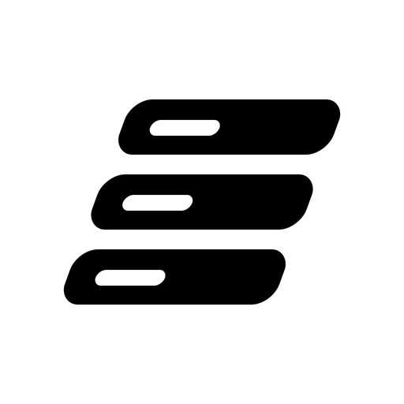

<p align="center">
  
</p>

# HostDeck

HostDeck 是一个跨平台远程主机工作台，在桌面式界面中集中管理 SSH 连接、终端、文件、Docker 和远端开发环境。支持 Electron 桌面应用与浏览器访问，也可通过 Agent CLI / MCP 接入本地 AI 工具。

当前项目由以下部分组成（Dart 包名为 `host_deck`）：

- Flutter 桌面壳：负责窗口承载、日志面板和内置后端服务，仅用于开发调试；Flutter 桌面 release 已弃用
- Dart CLI 服务：入口为 `bin/server.dart`，可独立以 B/S 模式运行
- Agent CLI：入口为 `bin/hostdeck_cli.dart`，供本地工具调用已运行的 HostDeck 服务
- Agent MCP：入口为 `bin/hostdeck_mcp.dart`，以 stdio MCP 服务形式向本地 Agent 暴露 HostDeck 能力
- Vue 3 前端：当前主前端位于 `host-deck-ui/`
- 桌面交互组件包：`host-deck-ui/packages/webos/`，提供可复用的窗口、Dock、启动台和桌面小组件
- Electron 桌面壳（Windows / macOS Apple Silicon）：复用 `host-deck-ui/` 前端和 Dart CLI 服务进行桌面打包
- pi-ai bridge：位于 `host-deck-ai/`，通过 Bun 编译为独立可执行程序，为 AI 运维 Agent 提供模型调用

当前开发、Docker 构建和发布流程都以 `host-deck-ui/` 为准。

## 功能概览

- SSH 登录与服务器保存
- 桌面式工作台、多窗口、Dock、启动台、快捷搜索、窗口切换器和桌面小组件
- 多会话终端
- Agent CLI / MCP，可通过本机 HostDeck 服务发现远端会话并执行命令、读写文件和应用 patch
- AI 运维 Agent（pi-ai bridge），提供目标绑定会话、结构化工具和敏感操作审批
- 通用内嵌 Web 应用窗口
- 远端 IDE（code-server）：支持 Linux 主机离线安装、同源代理和多目标会话
- 文件管理、收藏目录、桌面钉住目录
- 端口链接桌面钉住
- SSH TCP / HTTP 端口转发，支持从 Docker 已发布端口快捷创建 HTTP 转发
- SSH SOCKS5 代理与使用代理的独立 Chrome 安全浏览器
- 文本编辑与图片/视频预览
- 系统监控
- 运行态会话查看
- 操作日志查看与 Agent 日志筛选
- Docker 容器、镜像、网络、卷与 Compose 管理
- 主题、壁纸与终端字体设置
- 密码、Authenticator/TOTP 和 API Token 访问认证
- 原生 HTTPS / WSS、自签名证书生成与 PEM 证书导入

## 开发文档

开发文档入口为 [docs/README.md](docs/README.md)：

- [整体架构](docs/architecture.md)：运行形态和请求流转
- [后端开发](docs/backend.md)：Dart 服务端分层、路由和依赖组装
- [前端开发](docs/frontend.md)：Vue 前端目录、状态管理和 HTTP 约定
- [API 合约](docs/api-contract.md)：统一响应、错误处理和 WebSocket 约定
- [本地开发](docs/development.md)、[构建与发布](docs/build-and-release.md)、[测试与校验](docs/testing.md)
- [访问认证](docs/access-control.md)、[TLS 与证书管理](docs/tls.md)
- [远端 IDE](docs/modules/code-server.md)、[端口转发](docs/modules/port-forwards.md)
- [模块文档](docs/modules/)：认证、终端、文件、Docker、Agent CLI、桌面工作台等模块说明
- [桌面交互组件包](host-deck-ui/packages/webos/README.md)：`@host-deck/webos` 的使用与扩展

## 技术栈

### 后端 / 桌面壳

- Flutter
- Dart
- shelf / shelf_router / shelf_web_socket
- dartssh2
- sqlite3
- logging
- pi-ai bridge / OpenAI-compatible API（工具定义使用 LangChain.dart）

### 前端

- Vue 3
- TypeScript
- Vite
- Naive UI
- UnoCSS
- Pinia
- TanStack Vue Query
- Axios
- xterm.js
- Monaco Editor
- xgplayer
- Electron / electron-builder

## 前置要求

- Flutter SDK
- FVM（推荐，用于锁定 Flutter/Dart 工具链）
- Node.js 22.19+（低于 23，版本范围以根目录 `package.json` 为准）
- pnpm 10.34.5（仓库根目录 `package.json` 已固定版本）
- Bun 1.4+（构建 pi-ai 独立可执行程序）

先安装依赖：

```bash
git submodule update --init --recursive
fvm flutter pub get
pnpm run install:all
```

## 开发模式

### 1. 一键启动后端与前端

macOS / Linux：

```bash
./dev.sh
```

Windows PowerShell：

```powershell
.\dev.ps1
```

脚本通过 FVM 的 Dart SDK 启动后端，等待服务就绪后启动 Vite。默认后端地址为 `http://127.0.0.1:8080`，前端端口为 `5178`。运行期间按 `r` 重启后端，按 `q` 退出并停止前后端进程；Windows 前端使用隐藏的后台进程。

可指定端口，或在 macOS/Linux 调试 TOTP 登录：

```bash
./dev.sh --backend-port 9000 --frontend-port 5179
./dev.sh --totp-secret 'YOUR_BASE32_SECRET'
```

前后端 HTTPS 开发配置及 `dev-tls.sh` 用法见 [TLS 文档](docs/tls.md#vite-开发环境)。

### 2. Electron 桌面开发

先启动后端（可使用上面的一键开发脚本），再启动 Electron：

```bash
pnpm --dir host-deck-electron electron:dev
```

Electron 开发模式会分别从 `host-deck-ui/vite.config.ts` 和 `host-deck-electron/vite.config.mjs` 读取应用前端和壳界面的开发服务器地址，也可通过 `HOST_DECK_ELECTRON_APP_DEV_URL` 和 `HOST_DECK_ELECTRON_SHELL_DEV_URL` 覆盖。

### 3. Flutter 桌面壳调试模式

当前 Flutter 桌面调试模式会在 WebView 中加载 Vite 开发服务器，所以需要前端和 Flutter 同时启动。

终端 A：

```bash
pnpm --dir host-deck-ui dev
```

终端 B：

```bash
fvm flutter run -d windows
```

说明：

- Vite 开发服务器端口以 `host-deck-ui/vite.config.ts` 的 `server.port` 为准。
- `lib/main.dart` 的 Flutter debug WebView 与 Vite 默认统一使用 `http://localhost:5178`。
- Flutter 内置后端默认监听 `http://localhost:8080`
- Vite 将 `/api` 代理到 `VITE_DEV_PROXY_TARGET`，默认 `http://localhost:8080`；终端 WebSocket 使用 `/api/ws/terminal`

如需在 macOS/Linux 调试桌面壳，把 `windows` 替换为对应设备即可。

### 4. 纯 Dart B/S 模式

先构建前端，再启动 CLI 服务：

```bash
pnpm run build:web
HOSTDECK_ACCESS_PASSWORD=replace-with-a-strong-password dart run bin/server.dart --host 0.0.0.0 --port 8080 --web-dir host-deck-ui/dist
```

启动后访问 `http://localhost:8080`。

常用参数：

- `--host <value>`：绑定地址，默认 `127.0.0.1`
- `--port <value>`：监听端口，默认 `8080`
- `--web-dir <path>`：静态前端资源目录
- `--data-dir <path>`：sqlite 与配置文件目录
- `--log-dir <path>`：日志文件目录，默认是数据目录下的 `logs`
- `--log-max-days <days>`：日志最大保留天数，默认 `30`
- `--enable-secure-browser`：允许 Dart CLI 进程启动使用 SSH SOCKS 代理的 Chrome，默认关闭
- `--chrome-path <path>`：指定 Chrome 可执行文件路径；未指定时按系统标准安装路径自动探测
- `--tls <true|false>`：覆盖已保存的 TLS 开关
- `--tls-cert <path>`：PEM 证书链路径，服务端证书放在第一张
- `--tls-key <path>`：未加密的 PEM 私钥路径，需与证书链成对提供

如果未显式传入 `--web-dir`，`bin/server.dart` 会尝试从可执行文件旁的 `../web` 自动发现静态资源目录。

纯 B/S 服务同时向 `stderr` 和日志文件输出日志。日志文件按本地日期命名为 `hostdeck-server-YYYY-MM-DD.log`，服务启动及日期切换时会删除超过保留天数的日志文件。

非 loopback 监听必须配置 `HOSTDECK_ACCESS_PASSWORD`、`HOSTDECK_ACCESS_TOTP_SECRET` 或 `HOSTDECK_API_TOKEN`。浏览器可使用访问密码或 Authenticator 登录，Agent CLI 通过 `--token` 或 `HOSTDECK_TOKEN` 发送 Bearer Token；详见 [访问认证](docs/access-control.md)。仅本机访问时可省略 `--host`，默认绑定 `127.0.0.1`。

可在“设置 → 安全 → TLS 访问”中启用 HTTPS，也可首次启动时传入 `--tls true` 自动生成自签名证书。启用后使用原端口访问 `https://localhost:8080`，WebSocket 自动使用 WSS；界面保存的配置需重启服务后生效。证书导入、环境变量和客户端信任配置见 [TLS 文档](docs/tls.md)。

启用安全浏览器后，Web 页面会请求 Dart CLI 在服务所在机器启动独立 Chrome 配置目录，并强制使用 SSH 动态转发产生的本地 SOCKS5 代理。例如：

```bash
dart run bin/server.dart --web-dir host-deck-ui/dist --enable-secure-browser
```

停止代理或退出 CLI 不会强制关闭已经启动的 Chrome；代理失效后该 Chrome 不会回退到直接连接。Docker、无图形桌面的 Linux 或 Chrome 未安装环境应保持该开关关闭。

## 桌面发布构建

Flutter 桌面 release 已弃用：`pubspec.yaml` 不再声明 `assets/web/`，发布工作流中的 Flutter 桌面 job 也已注释。桌面安装包统一使用 Electron 构建。

GitHub Actions 的 [.github/workflows/release.yml](.github/workflows/release.yml) 在推送 `v*` 标签时运行，发布以下产物：

- Docker 镜像 tar.gz
- Windows Agent CLI zip（`bin/hostdeck_cli.dart` + pi-ai bridge，需连接已运行的 HostDeck 服务）
- Electron Windows exe/zip
- Electron macOS Apple Silicon dmg/zip

Flutter 桌面（Linux、macOS、Windows）、Android 和纯 Dart bundle 的发布 job 目前保留在工作流中但处于注释状态。

Electron 打包复用 `build-web` 生成的前端 artifact；Docker 构建在镜像内部重新构建前端、Dart 服务与 pi-ai bridge。

### Electron 构建

Electron 壳（Windows、macOS Apple Silicon）位于 `host-deck-electron/`，其中 `src/main/` 承载主进程、`src/preload/` 承载桥接层、`src/renderer/` 使用 Vue 构建壳界面。构建时会先生成 Dart CLI 服务 bundle，再把前端 `host-deck-ui/dist/` 和服务可执行文件打入安装包；开发模式下分别使用 `HOST_DECK_ELECTRON_APP_DEV_URL` 和 `HOST_DECK_ELECTRON_SHELL_DEV_URL` 覆盖两个 Vite 地址。

Electron 的服务构建脚本会执行 `flutter pub get`，若该步骤失败但 `.dart_tool/package_config.json` 已存在，会继续使用现有依赖配置执行 `dart compile exe`；因此 Electron 打包本身不强制依赖 `fvm` 命令可用。

```bash
pnpm --dir host-deck-electron install --frozen-lockfile
pnpm run build:electron:win
# macOS Apple Silicon
pnpm run build:electron:mac
```

构建结果位于 `host-deck-electron/release/`。

## 纯 Dart 服务打包

macOS / Linux 可直接使用脚本构建服务 bundle：

```bash
pnpm run build:server:unix
```

Windows PowerShell：

```powershell
.\scripts\build_server.ps1
```

脚本会安装并构建 `host-deck-ui/`，执行 `flutter pub get` 和 `dart build cli`，用 Bun 编译 pi-ai bridge，再把前端产物复制到 `build/server/bundle/web/`，并生成 `build/server/start_server.bat`。

也可以手动构建：

```bash
pnpm --dir host-deck-ui build
flutter pub get
dart build cli --target bin/server.dart --output build/server
node scripts/build_ai.mjs build/server/bundle
# 将 host-deck-ui/dist 的内容同步到 build/server/bundle/web/
```

构建结果位于 `build/server/bundle/`：

- `build/server/bundle/bin/server(.exe)`：服务可执行文件
- `build/server/bundle/lib/`：运行时动态库
- `build/server/bundle/ai/bridge(.exe)`：Bun 编译的 pi-ai 可执行程序
- `build/server/bundle/web/`：前端静态资源

说明：`scripts/build_server.ps1` 和 `scripts/build_server.sh` 都使用当前前端目录 `host-deck-ui/`。

## Agent CLI

`bin/hostdeck_cli.dart` 用于让本地工具通过已经运行的 HostDeck 服务操作远端服务器；CLI 不直接持有 SSH 凭据，连接、限流和操作日志仍由 HostDeck 服务端管理。未传 `--hostdeck-url` 时会按 `HOSTDECK_URL`、`~/.config/host-deck/instance.json`、`http://127.0.0.1:8080` 的顺序发现服务。

常用命令：

```bash
hostdeck_cli discover
hostdeck_cli sessions
hostdeck_cli exec --connection <id> --cwd /repo -- git status --short
hostdeck_cli read --connection <id> --path /var/www/app/package.json
hostdeck_cli write --connection <id> --path /tmp/demo.txt --file local.txt
hostdeck_cli patch --connection <id> --cwd /repo --file fix.diff
```

构建命令：

```bash
./scripts/build_hostdeck_cli.sh
```

详细说明见 `docs/modules/agent-cli.md`。

## Agent MCP

`bin/hostdeck_mcp.dart` 把 Agent CLI 同样的能力包装成 stdio MCP 服务（newline-delimited JSON-RPC 2.0，协议版本 `2025-06-18`），供 Claude Code、Codex、OpenCode 等本地 Agent 直接挂载调用。服务发现顺序与 CLI 一致：`--hostdeck-url` > `HOSTDECK_URL` > `~/.config/host-deck/instance.json` > `http://127.0.0.1:8080`，认证使用 `--token` 或 `HOSTDECK_TOKEN`。

暴露的工具：

- `hostdeck_discover`：解析并探测 HostDeck 服务地址
- `hostdeck_sessions`：列出 SSH 连接/会话，获取 `connectionId`
- `hostdeck_exec`：执行远端命令（检查 `data.exitCode` 与 `data.truncated`）
- `hostdeck_read_file` / `hostdeck_write_file`：读写远端文本文件
- `hostdeck_apply_patch`：在远端 Git 仓库先 `git apply --check -` 再 `git apply -`

MCP 客户端配置示例：

```json
{
  "mcpServers": {
    "hostdeck": {
      "command": "hostdeck_mcp",
      "env": { "HOSTDECK_TOKEN": "<token-if-needed>" }
    }
  }
}
```

构建命令：

```bash
./scripts/build_hostdeck_mcp.sh
```

详细说明见 `docs/modules/agent-mcp.md`。

## Docker

`Dockerfile` 会直接构建 `host-deck-ui/`、Dart CLI 服务与 pi-ai bridge。构建并使用访问密码启动：

```bash
docker build -t host-deck:local .
docker run --rm -p 8080:8080 -v host-deck-data:/data \
  -e HOSTDECK_ACCESS_PASSWORD='replace-with-a-strong-password' \
  host-deck:local
```

也可以使用 Docker Compose 启动。将 TOTP Secret 放在项目根目录的 `.env` 中，或直接通过环境变量传入：

```bash
HOSTDECK_ACCESS_TOTP_SECRET='YOUR_BASE32_SECRET' docker compose up -d
```

Compose 配置位于 `compose.yaml`，数据会持久化到 `host-deck-data` 卷。

容器默认监听非 loopback 地址，因此必须配置访问认证。当前 Compose 文件透传 `HOSTDECK_ACCESS_TOTP_SECRET`；直接使用 `docker run` 时，也可传入 `HOSTDECK_ACCESS_PASSWORD` 或 `HOSTDECK_API_TOKEN`。原生 TLS 配置可通过 `/data` 卷持久化，详见 [TLS 文档](docs/tls.md)。

容器默认启动参数：

- `--host 0.0.0.0`
- `--port 8080`
- `--web-dir /app/web`
- `--data-dir /data`

## 常用校验命令

仓库根目录：

```bash
pnpm run check
pnpm run test
```

`check` 依次执行前端类型检查、AI bridge 测试和 Dart 分析；`test` 依次执行前端、AI bridge 和 Dart 测试。

也可单独校验 Dart：

```bash
fvm flutter analyze
fvm flutter test
```

前端：

```bash
pnpm --dir host-deck-ui build
pnpm --dir host-deck-ui exec vue-tsc -p tsconfig.app.json --noEmit
pnpm --dir host-deck-ui test
```

单个前端测试示例：

```bash
pnpm --dir host-deck-ui exec vitest run src/views/Files/components/__tests__/FilePickerDialog.spec.ts
```

AI bridge：

```bash
pnpm --dir host-deck-ai test
pnpm --dir host-deck-ai test:bin
```

`test:bin` 用于验证独立可执行程序，需先执行 `pnpm run build:ai:bin`。

## 项目结构

```text
host_deck/
├── bin/                 # Dart CLI 服务、Agent CLI 与 MCP 入口
├── docs/                # 架构、开发、构建、测试与模块文档
├── lib/                 # Flutter 桌面壳与内置后端服务
├── host-deck-ui/        # 当前主前端工程
│   └── packages/webos/  # 可复用的 Vue 桌面交互组件包
├── host-deck-electron/  # Electron Windows / macOS arm64 桌面壳
├── host-deck-ai/        # pi-ai bridge 工程（Bun 独立可执行程序）
├── package.json         # 仓库级 Node 命令编排入口
├── scripts/             # 服务打包、发版脚本
├── test/                # Flutter/Dart 测试
└── README.md
```

## 开源协议

HostDeck 自本次许可变更后的版本起采用 [GNU General Public License v3.0 only](LICENSE)
开源。此前已经按 MIT License 发布的版本继续适用其原有许可。

仓库包含按各自许可证分发的第三方素材，详情参见
[THIRD_PARTY_NOTICES.md](THIRD_PARTY_NOTICES.md)。
